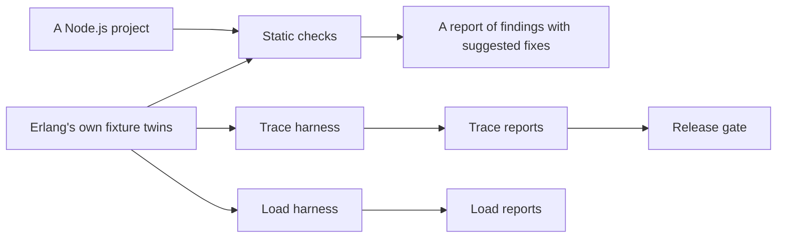

# Erlang

[](https://github.com/atishaypahadiya/Erlang/actions/workflows/ci.yml)

[Release v0.1.0](https://github.com/atishaypahadiya/Erlang/releases/tag/v0.1.0) · [Contract](docs/CONTRACT.md) · [Changelog](CHANGELOG.md)

Erlang is named after A. K. Erlang, the queueing theorist. It is not the Erlang programming language and has nothing to do with it.

You give it the directory of a Node.js web service, and it gives back a report of the load and resilience defects it can read in the source, each with the rule it breaks and a suggested fix.

This page describes version <!--n:version-->0.1.0<!--/n-->, as tagged.

```
$ node bin/erlang.js fixtures/L07-no-timeout/planted
warning no-timeout  src/avatars.js:5  http.request in avatar sets a timeout, but the timeout option only emits a 'timeout' event: nothing destroys the request when it fires, so the request still waits forever.
error   no-timeout  src/db.js:3  The pg Pool pool sets no statement_timeout or query_timeout, so a slow query can run forever, and no connectionTimeoutMillis, so waiting for a free connection can last forever; pg's default for each is no timeout.
error   no-timeout  src/geo.js:5  https.get in lookup has no deadline: no signal, no timeout, and no setTimeout on the request.
error   no-timeout  src/inventory.js:6  stockLevel calls fetchJson with no signal, so the fetch in it (src/http.js:3) has no deadline.
error   no-timeout  src/payments.js:5  fetch in charge has no deadline: no signal is passed, and Node's fetch never times out a whole request by itself.
error   no-timeout  src/quotes.js:5  fetch in getQuote has no deadline: no signal is passed, and Node's fetch never times out a whole request by itself.
error   no-timeout  src/rates.js:7  got in rate has no timeout; got sets none by default.
info    no-timeout  src/search.js:6  Whether this fetch call in search has a deadline is unknown: its options or signal come from code ERLANG cannot read.
error   no-timeout  src/shipping.js:6  axios.get in track has no timeout; axios's default is 0, which never times out.
warning no-timeout  src/thumbnails.js:6  https.get in thumbnail sets a timeout, but the timeout option only emits a 'timeout' event, and its handler (src/thumbnails.js:7) does not destroy or abort the request, so the request still waits forever.
error   no-timeout  src/clients.ts:3  The axios instance billing has no timeout (axios's default is 0, none), and the call on it sets none: src/invoices.ts:4.
complete: 10 failing (8 error, 2 warning), 1 info. Report: dist/reports/planted/report.json
```

The output of `node bin/erlang.js fixtures/L07-no-timeout/planted`, run from a checkout of tag v0.1.0 on 26 November 2026. The command exited with code 1. The subject is the planted twin of Erlang's own fixture for missing timeouts.

## Who it's for

**Someone who maintains a Node.js service** written with Express, Fastify, `node:http` or Next.js, on PostgreSQL through `pg` or Prisma.

- Today: `erlang <dir>` reads the source and reports what its static checks find, with a suggested fix for every finding and an exit code a pipeline can act on. It runs nothing and sends no request. The verdicts on your code are static only, and their accuracy outside Erlang's own fixtures has not been measured.
- Next: printed messages will write the name as "Erlang" where some still write it in capitals. This is not built.

**Someone who wires a checker into a pipeline or another tool.**

- Today: the report is report/1 with finding/1 findings, the formats Itten and Kerckhoffs also write, with fingerprints that hold from one run to the next and the same exit codes as those two. What a caller can rely on is written down in [docs/CONTRACT.md](docs/CONTRACT.md).
- Next: the shared JSON Schema validator will support `const` and `if`/`then`, in the shared core first and then in the pinned copy here. This is not built.

**Someone who works on Erlang, or who wants to see what its claims rest on.**

- Today: the fixtures plant every defect in one twin and fix it in the other, and two harnesses confirm the static checks on those twins, one by counting what each request does and one under load. A release gate decides whether a commit can be tagged.
- Next: a script that derives the coverage table below from fingerprints and fails on a planted defect that a mode neither finds nor explains; a wider margin for one thin timing row (L09's signup); the load judge checking error statuses and agreement across repeats, as the trace does; and corrections to two fixture notes. None of this is built.

## Part of a set

Erlang, [Itten](https://github.com/atishaypahadiya/Itten) and Kerckhoffs are one set, and each checks a different side of the same app: Erlang its load and resilience, Itten its design, and Kerckhoffs its security.
Each one stands alone. All three write their findings as finding/1 inside a report/1, and all three use the same exit codes.

## What it does



Only the static checks run on a project Erlang has never seen. The trace and load harnesses run only on Erlang's own twins, so they support no claim about outside code.

### Static checks

There are <!--n:checks-->15<!--/n--> checks. Each reads source and configuration only, and each finding comes with a suggested fix, either complete edits or the places to change with a note. Erlang never applies a fix.

- **`no-timeout`** (TMO-01): outbound calls that nothing bounds in time, through fetch, axios, got, `node:http`, `node:https` and `pg`.
- **`n-plus-one`** (DAT-01) and **`per-row-writes`** (DAT-02): a query or a write sent once per item of a list, in code a request handler reaches, through `pg` or Prisma.
- **`unbounded-query`** (STB-04): a list read with no limit, or with a page size the client chooses and nothing caps.
- **`missing-index`** (DAT-03): columns that queries filter, join or sort on, and foreign keys, with no index in the SQL migrations or `schema.prisma`.
- **`oversized-payload`** (DAT-04, DAT-08, DAT-09): `SELECT *` in a statement that can return many rows, an app that sends responses uncompressed, and page code that calls its own service once per item.
- **`retry-policy`** (RTY-01, RTY-02, RTY-03, RTY-06) and **`retry-budget`** (RTY-05): retries with no cap, no backoff or no jitter, retries of replies that cannot succeed, retries stacked at several layers, and retries that nothing limits across requests.
- **`pool-sizing`** (CAP-08, OVL-11): pools that, across every process the Compose, Kubernetes or PM2 files start, can open more connections than the database accepts, and a pool made per request.
- **`pool-exhaustion`** (STB-08, STB-09): a connection not released on every path, or held while the code waits on another service.
- **`blocking-work`** (OVL-12): synchronous calls that hold up the request thread, such as `crypto.pbkdf2Sync`, `*Sync` functions of `node:fs` and `node:zlib`, and bcryptjs at a cost of 10 or more.
- **`memory-growth`** (STB-05): a module-level collection that requests add to and nothing removes from.
- **`no-cache`** (DAT-06): a read repeated with the same arguments, and, as info, a whole-table aggregate behind a GET with nothing in front of it.
- **`cold-start`** (STB-10): a value every request depends on, built by the first request that needs it instead of at startup.
- **`no-load-shedding`** (OVL-02, OVL-03): a server with nothing that caps the requests in flight.

The rules are in `reference/`, which holds <!--n:rules-->70<!--/n--> rules in <!--n:rule-files-->7<!--/n--> files with their sources. The checks cover the ones named above.

- **Limits of the stack.** Erlang reads Node.js only. Database access is read through `pg` and Prisma, and Drizzle is not read. Request handlers are found in Express, Fastify, `node:http` and Next.js code only.
- **Configuration.** An `erlang.config.json` at the root of `<dir>` can exclude paths, name entry points Erlang cannot find, name tables that stay small, give the database's `max_connections`, and name a warm-up route.

### Trace harness

- **What it runs.** Each fixture form's two twins are served against PostgreSQL in Docker, one request at a time on 127.0.0.1. There are <!--n:trace-forms-->19<!--/n--> trace forms, so one run writes <!--n:trace-reports-->38<!--/n--> reports.
- **What it judges.** Findings come from counts: the statements, rows, calls, bytes and connections of each request, query plans, and attempts at an upstream stub that fails or never answers. Memory is judged on heap slopes over soaks, and cold starts on the first request of fresh processes.
- **Its limit.** It runs on Erlang's own twins only.

### Load harness

- **What it runs.** k6 drives both twins of a form at a fixed arrival rate. There are <!--n:load-forms-->14<!--/n--> load forms. The full suite runs in CI.
- **What it judges.** Each twin is judged against the other, never against an absolute number.
- **Its limits.** It refuses any target that is not a twin it started on 127.0.0.1, and its rates and durations are capped. A defect that both twins have is not seen.

### Timing rules

- **Counts never depend on the machine.** A verdict that rests on a count is judged as measured.
- **The relative timing rule.** A timed verdict compares two conditions measured together and needs at least <!--n:repeats-->5<!--/n--> repeats. It is a finding when every repeat clears the threshold, nothing when none does, and an info "timing unreliable" for a mix. That info never fails a run.
- **Declared waits.** A fixed wait between retries is judged on the delay the code declares, recorded from the twin's timers, and not on a clock.
- **Margins on the fixtures.** The fixture suite fails when the median of a planted defect's samples clears its bar by less than twice, or when a decoy's median comes more than half way to its bar.
- **Headroom.** At every load step's rate, the clean twin's main thread must be busy at most <!--n:headroom-max-->0.2<!--/n--> of the time on the median of ten measurements, and two or more measurements over <!--n:headroom-one-->0.3<!--/n--> fail outright.

### Release gate

- **Green runs.** A commit is tagged only when its last <!--n:gate-runs-->5<!--/n--> completed CI runs are all green.
- **Identical trace reports.** The trace reports of those runs, and of a local run on a second machine, must be identical apart from what each finding lists as measured.
- **Planted rows hold.** Every planted row's finding must be present in every run with the same rule, severity and fingerprint, and must never read "timing unreliable". No row with nothing planted may be an error or a warning.
- **Fits hold.** A planted row judged on a fitted heap slope needs a median R² at least half way from the judge's bar to 1, which is 0.95 for the trace's bar of 0.9.
- **Its limit.** The gate compares Erlang's own fixture runs. It says nothing about code outside the fixtures.

## Numbers

A number written with a marker in this file's source is compared with its source by `scripts/readme-numbers.js`, which `npm test` runs, so CI's `test` job fails when one drifts. Each table says which of its numbers are checked that way.

### The fixtures

Source: the `fixtures/` tree at v0.1.0, counted on 26 November 2026. These are counts of files and entries, so they do not depend on a machine. CI checks every number in this table.

| Quantity | Count |
|---|---|
| Defect classes (L01a to L13) | <!--n:classes-->14<!--/n--> |
| Twin pairs with a defects file | <!--n:pairs-->21<!--/n--> |
| Planted defects | <!--n:planted-->86<!--/n--> |
| Decoys, present in both twins, that must not be reported | <!--n:decoys-->135<!--/n--> |
| Trace forms | <!--n:trace-forms-->19<!--/n--> |
| Load forms | <!--n:load-forms-->14<!--/n--> |

### Coverage per mode

Source: a recount on 26 November 2026 from the fixtures' defects files, the trace and load forms, and the reports of the five release runs of 21 November 2026 on GitHub-hosted `ubuntu-24.04` runners, recorded in the opening of `CHANGELOG.md`. CI derives the planted total and the documented expected misses from the fixture files. It compares the found and not-exercised counts of the trace and load rows with the changelog's sentence and checks that each row adds up to the planted total. It does not derive those four counts again, because the run reports are not in the tree. The script that would is listed for 0.1.1 and is not built.

| Mode | Planted | Found | Documented expected misses | Not exercised |
|---|---|---|---|---|
| Static | <!--n:planted-->86<!--/n--> | <!--n:static-found-->86<!--/n--> | 0 | 0 |
| Trace | <!--n:planted-->86<!--/n--> | <!--n:trace-found-->65<!--/n--> | <!--n:trace-misses-->2<!--/n--> | <!--n:trace-none-->19<!--/n--> |
| Load | <!--n:planted-->86<!--/n--> | <!--n:load-found-->33<!--/n--> | <!--n:load-misses-->1<!--/n--> | <!--n:load-none-->52<!--/n--> |

No clean twin reports anything. Recall and precision are 1.00 in each mode, stated over the defects that mode exercises and excluding the documented expected misses. These figures describe Erlang's own fixtures and nothing else.

### The release gate on the tagged commit

Source: `scripts/release-gate.sh` run on 26 November 2026 against commit 9a18ae9, reading the artifacts of the five CI runs below and a local trace. The CI runs were on GitHub-hosted `ubuntu-24.04` runners with Node 22. The local trace ran on 21 November 2026 on a Mac under macOS 27.3 with Node v25.5.0 and Docker engine 29.8.2. CI ran the gate again on the tag, in the `release-gate` job of run 45830371978 on 26 November 2026, which passed; that job compares the five CI runs and not the local trace. CI does not check the copies of these figures in this file, because run data is not in the tree.

| CI run | Started (UTC) | Trigger | Conclusion |
|---|---|---|---|
| 44912473102 | 21 November 2026, 14:09 | push | success |
| 44915040697 | 21 November 2026, 14:39 | workflow_dispatch | success |
| 44917435140 | 21 November 2026, 15:06 | workflow_dispatch | success |
| 44920172878 | 21 November 2026, 15:37 | workflow_dispatch | success |
| 44922874323 | 21 November 2026, 16:08 | workflow_dispatch | success |

| Gate condition | Result |
|---|---|
| Trace reports identical across the five CI runs and the local trace | 38 reports identical across 6 runs |
| "Timing unreliable" infos on rows with nothing planted | 0 across 6 runs |
| Fit of L05's two planted trace rows, searchProducts and placeCart | R² 1.000 in each of 6 runs, against a bar of 0.9 and a margin of 0.95 |

A run of CI on the tagged tree has <!--n:ci-jobs-->18<!--/n--> jobs when it is a tag's run: the tests, the trace, the release gate, the list of load forms, one job for each load form but L05, and L05's own longer job. CI checks that count against the workflow file and the load forms.

### A thin margin

Source: local trace runs on the Mac, on 21 November 2026, recorded in the thin-margins table of `CHANGELOG.md` one commit after the tag. CI compares the two medians with the changelog's row. The ratios are those medians divided by the margin.

| Row | macOS 27.2 | macOS 27.3 | Margin | Sizing rule |
|---|---|---|---|---|
| L09 trace, planted signup stretch (`POST /signup`, `crypto.pbkdf2Sync`), median | <!--n:signup-27.2-->114.43<!--/n--> ms, 1.14 times the margin | <!--n:signup-27.3-->121.96<!--/n--> ms, 1.22 times the margin | 100 ms, twice the bar of 50 ms | 1.3 times the margin |

The verdict was right in every run. The other thin margins are listed in `CHANGELOG.md` under the release's known limits.

## Quality gates

| Gate | What fails it |
|---|---|
| Core pin (`scripts/core-pin-test.js`) | A file of the pinned shared core differs from its recorded SHA-256, or a file is added to or missing from `core/`. |
| Unit cases (`scripts/unit-test.js`) | Any case does not hold. |
| Fixture suite (`scripts/fixture-test.js`) | A planted defect is not caught, or anything else is reported on either twin, decoys included. |
| Fix test (`scripts/fix-test.js`) | An automatic fix does not clear its finding, adds a finding, or leaves a file that no longer parses. |
| CLI test (`scripts/cli-test.js`) | A documented invocation gives the wrong exit code or writes its report in the wrong place. |
| Self-scan (`scripts/self-scan.js`) | Erlang reports any finding on its own repository, or the report is not complete. |
| Hygiene test (`scripts/hygiene-test.sh`) | The commit hygiene check lets through a case it should refuse, or refuses one it should allow. |
| Load smoke (`scripts/load-smoke.sh`) | A twin does not start, take requests and write its raw output. It is skipped, with a message, when k6 or Docker is absent. |
| README numbers (`scripts/readme-numbers.js`) | A marked number in this file no longer matches its source. |
| Trace (CI job `trace`) | A planted row is not found, a row with nothing planted is reported, or a planted or decoy margin does not hold. |
| Headroom (CI job `trace`) | A load form's clean twin is too busy at a judged step's rate. |
| Load (CI jobs `load` and `load-long`) | A planted step is not found, a margin does not hold, or the planted twin fails or refuses a request in a form that does not expect failures. |
| Release gate (`scripts/release-gate.sh`, and CI job `release-gate` on a tag) | Any of the last five runs is not green, two trace reports differ in anything not listed as measured, a planted row is missing or reads "timing unreliable", or a fit does not hold. |

The first nine gates run in `npm test`, and CI's `test` job runs `npm test`. CI runs on every push to `main` and every pull request, except those that change only Markdown, and on every pushed `v*` tag.

## Run it

The static checks need Node.js <!--n:node-->22<!--/n--> or later and one `npm install`, which fetches TypeScript <!--n:typescript-->6.0.3<!--/n-->. The trace harness also needs Docker. The load harness needs Docker and k6, which you install yourself; CI uses k6 <!--n:k6-->v2.3.0<!--/n-->.

```
npm install
node bin/erlang.js <dir> [--out <file>]
npm test
npm run trace
npm run load -- <form>
```

- `node bin/erlang.js <dir>` checks a project. This is the only command that is for code other than Erlang's own.
- `npm test` runs every test of Erlang itself.
- `npm run trace` runs the trace harness on the fixtures.
- `npm run load -- <form>` runs the load harness on one fixture form.

After cloning, run `scripts/setup.sh` once to enable the commit hooks.

## Exit codes and output format

| Code | Meaning |
|---|---|
| 0 | The run is complete and has no failing findings. |
| 1 | There are failing findings. |
| 2 | The run was refused: the directory or its config cannot be read. |
| 3 | The run is partial and has no failing findings. |
| 64 | The usage was wrong. |
| 70 | Erlang failed internally, and stderr says what failed. |
| 75 | Harnesses only: Itten's timing lock stayed active, so nothing was judged. `erlang <dir>` never returns it. |

Errors and warnings fail a run. Info never does.

- **Standard output** has one line per finding, with its severity, check, file and line, and message, and a last line with the status, the counts and the report's path. It is for people.
- **The report** is the interface. It is one JSON file in report/1, written to `<file>` when `--out` is given and otherwise to `dist/reports/<dir name>/report.json` inside the Erlang directory. A refused or partial report is still written.
- **Each finding** is finding/1, with its check, severity, fingerprint, message, rules and locations, and a suggested fix in `erlang.fix`.
- **The schemas** are in `core/schema/` for report/1 and finding/1, and in `schema/` for the config and Erlang's own finding fields.

## Known limits

The full lists are in the [release notes](https://github.com/atishaypahadiya/Erlang/releases/tag/v0.1.0) and in `CHANGELOG.md`.

- **Fixtures only.** The harnesses run on Erlang's own twins. On a real project, Erlang's verdicts are static. The held-out set has not been planted or scored, so accuracy outside the fixtures is not measured.
- **Stacks.** Erlang reads Node.js only. It reads database access through `pg` and Prisma, and does not read Drizzle. It does not count postgres.js, mysql2 or Knex pools. It finds handlers in Express, Fastify, `node:http` and Next.js only.
- **Static blind spots.** Erlang misses statements built at run time, lists that come from the client, queue-draining loops, partial jitter, other retry libraries and other pools, and work done through code it cannot follow. They are listed in `fixtures/PLAN.md` under Known gaps.
- **Detection floor for leaks.** A leak under about 512 bytes a request in the trace, or under three times the clean twin's own retention under load, is not detected. L05's `POST /orders` is kept as a documented expected miss.
- **Found statically only.** L09-4, L05-3 and L03-s4 are found by the static checks alone, and L09-5 is a documented expected miss of the trace. L12 can be tested only under load.
- **The two harnesses differ.** The trace and load judges measure different quantities with their own bars, so one can find a defect the other misses. The differences are listed form by form in the changelog.
- **A thin margin.** L09's planted signup stretch in the trace clears its margin by less than the sizing rule asks, as the table above shows.
- **Wrong text in the tagged tree.** The tagged changelog says every planted defect is found in every mode; the counts above replace that claim. The tagged tree names bcryptjs's `hashSync` as bcrypt's in `fixtures/PLAN.md` and in one decoy's title. The note in `fixtures/L05-memory-growth/trace/trace.json` says L05-3 is confirmed by the load soak, which is wrong. No verdict reads any of these texts.
- **Matched by title.** Two mappings in the coverage counts, L03-p3 and L04-1 to L04-3, were matched to their trace rows by title and not by fingerprint.
- **The name in capitals.** Some printed messages still write the name in capitals, as the output above shows.
- **Owner's services only.** The load harness refuses any target that is not a twin it started on 127.0.0.1.

## Layout

```
bin/          the command
lib/          reading the source, the shared parts of the checks and harnesses
checks/       the static checks
scripts/      the tests, the trace and load harnesses, and the release gate
schema/       schemas for erlang.config.json and Erlang's own finding fields
core/         a pinned copy of the shared finding/1 and report/1 code (core.pin.json)
reference/    the rules Erlang checks against, with their sources
research/     the failure model, prior art, the name, and the harness designs
fixtures/     the planted and clean twins of each defect class (fixtures/PLAN.md)
docs/         the contract and the decisions it cites
```

## License and terms

The code in `bin/`, `lib/`, `checks/`, `scripts/`, `schema/`, `core/`, `fixtures/` and `research/probes/` is under the MIT License, in `LICENSE`. The documents are under CC BY 4.0, with attribution to Atishay Pahadiya: `CHANGELOG.md`, this README, and `docs/`, `reference/` and `research/` apart from `research/probes/`, each of those folders with its own `LICENSE`.

Erlang tests the owner's own services only. Its load harness never targets a third-party or production system.
