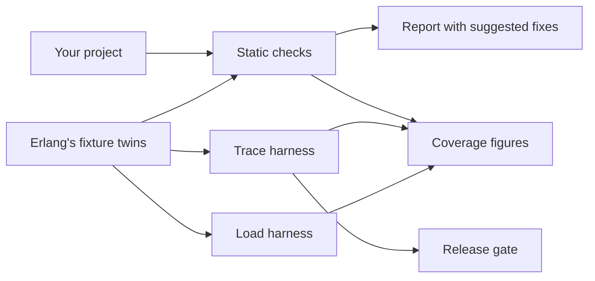

# Erlang

[](https://github.com/atishaypahadiya/Erlang/actions/workflows/ci.yml)

[Release v0.1.0](https://github.com/atishaypahadiya/Erlang/releases/tag/v0.1.0) · [Reference](docs/reference/README.md) · [How it works](docs/explanation.md) · [Changelog](CHANGELOG.md)

Erlang reads the source of a Node.js web service and reports, with a suggested fix for each, the defects that make it fail under load or when a dependency fails: missing timeouts, retry storms, unbounded queries, per-item queries, exhausted pools and blocking work.

It is named after A. K. Erlang, the queueing theorist, and it is not the Erlang programming language. This page describes version <!--n:version-->0.1.0<!--/n-->, as tagged.

## A real result

```text
$ node bin/erlang.js fixtures/L07-no-timeout/planted
warning no-timeout  src/avatars.js:5  http.request in avatar sets a timeout, but the timeout option only emits a 'timeout' event: nothing destroys the request when it fires, so the request still waits forever.
error   no-timeout  src/db.js:3  The pg Pool pool sets no statement_timeout or query_timeout, so a slow query can run forever, and no connectionTimeoutMillis, so waiting for a free connection can last forever; pg's default for each is no timeout.
error   no-timeout  src/geo.js:5  https.get in lookup has no deadline: no signal, no timeout, and no setTimeout on the request.
error   no-timeout  src/inventory.js:6  stockLevel calls fetchJson with no signal, so the fetch in it (src/http.js:3) has no deadline.
error   no-timeout  src/payments.js:5  fetch in charge has no deadline: no signal is passed, and Node's fetch never times out a whole request by itself.
error   no-timeout  src/quotes.js:5  fetch in getQuote has no deadline: no signal is passed, and Node's fetch never times out a whole request by itself.
error   no-timeout  src/rates.js:7  got in rate has no timeout; got sets none by default.
info    no-timeout  src/search.js:6  Whether this fetch call in search has a deadline is unknown: its options or signal come from code ERLANG cannot read.
error   no-timeout  src/shipping.js:6  axios.get in track has no timeout; axios's default is 0, which never times out.
warning no-timeout  src/thumbnails.js:6  https.get in thumbnail sets a timeout, but the timeout option only emits a 'timeout' event, and its handler (src/thumbnails.js:7) does not destroy or abort the request, so the request still waits forever.
error   no-timeout  src/clients.ts:3  The axios instance billing has no timeout (axios's default is 0, none), and the call on it sets none: src/invoices.ts:4.
complete: 10 failing (8 error, 2 warning), 1 info. Report: dist/reports/planted/report.json
```

This is the output of `node bin/erlang.js fixtures/L07-no-timeout/planted`, run from a checkout of tag v0.1.0 on 26 November 2026, which exited with code 1. The subject is the planted twin of Erlang's own fixture for missing timeouts, where every defect is put in on purpose. A run on a project Erlang had never seen is under [Evidence](#evidence).

## Who it's for

**Someone who maintains a Node.js service** written with Express, Fastify, `node:http` or Next.js, on PostgreSQL through `pg` or Prisma.

- Today: `erlang <dir>` reads the source and reports what its static checks find, with a suggested fix for every finding and an exit code a pipeline can act on. It runs nothing and sends no request. Its accuracy outside Erlang's own fixtures has not been measured.
- Next: printed messages will write the name as "Erlang" where some still write it in capitals. This is not built.

**Someone who wires a checker into a pipeline or another tool.**

- Today: the report is report/1 with finding/1 findings, with fingerprints that hold from one run to the next and fixed exit codes, all described in the [reference](docs/reference/README.md).
- Next: the shared JSON Schema validator will support `const` and `if`/`then`. This is not built.

**Someone who works on Erlang, or wants to see what its claims rest on.**

- Today: every defect class has a planted twin and a clean twin, two harnesses confirm the static checks on those twins, and a release gate decides whether a commit can be tagged.
- Next: a script that derives the coverage table under [Evidence](#evidence) from fingerprints, a wider margin for L09's signup row, and corrections to two fixture notes. None of this is built.

## Get your first finding

You need git and Node.js <!--n:node-->22<!--/n--> or later. The static checks need nothing else: no database, no Docker and no running service.

1. Get Erlang and its one dependency, TypeScript <!--n:typescript-->6.0.3<!--/n-->.

    ```bash needs=network
    git clone https://github.com/atishaypahadiya/Erlang.git
    cd Erlang
    npm install
    ```

2. Check that it runs. It prints its version and the commit it runs from.

    ```bash
    node bin/erlang.js --version
    ```

3. Name the project to check. The line below points at one of Erlang's own fixtures so that it works as written; replace the path with your service's directory.

    ```bash
    PROJECT=fixtures/L07-no-timeout/planted
    ```

4. Run the checks. Each finding is one line with its severity, check, file and line, and the last line counts them. The exit code is 1 when any finding is an error or a warning, 0 when none is, and 2 when the directory cannot be read.

    ```bash exit=1
    node bin/erlang.js "$PROJECT" --out dist/first-report.json
    ```

5. Read the suggested fix of the first finding in the report. An `auto` fix gives the edits; a `guided` fix gives the places to change and a note.

    ```bash
    node -e 'const f = require("./dist/first-report.json").findings[0]; console.log(f.check, f.where.locations[0], f.erlang.fix.kind, f.erlang.fix.note ?? "")'
    ```

6. If findings come from code that never serves a request, such as build scripts, tests or code bundled for the browser, list those paths in an `erlang.config.json` at the root of your project and run step 4 again. Erlang reads every source file under the directory and cannot tell which of them the server runs.

    ```json
    { "exclude": ["scripts/", "tests/"] }
    ```

Every key of the config is in [docs/reference/config.md](docs/reference/config.md), and every check with its thresholds is in [docs/reference/checks.md](docs/reference/checks.md).

## How it compares

Clinic.js and k6 are what a reader of this page is likely to know already. The rows below come from their READMEs as read on 26 November 2026 ([Clinic.js](https://github.com/clinicjs/node-clinic/blob/19262605b5647d34e660294e93c0cee62ea3a746/README.md) at commit 1926260, [k6](https://github.com/grafana/k6/blob/14c4018eb64d3f9f3a3d1bf16471ea40cb0f5027/README.md) at commit 14c4018) and, for Erlang, from this repository.

| | Erlang 0.1.0 | Clinic.js | k6 |
| --- | --- | --- | --- |
| What it needs | The source directory. | Your server, started under it, and a benchmark such as autocannon. | A test script and a running service to send load to. |
| What it gives | Findings in the source, each with a rule and a suggested fix. | A diagnosis of the type of issue and a recommended next tool, with visualisations. | Metrics, and thresholds that set goals for a test, exported to the service of your choice. |
| Measures your running service | No. Its trace and load harnesses run only on Erlang's own twins. | Yes. | Yes. |
| Install | Clone and `npm install`; there is no published package. | `npm install -g clinic`. | Released binaries. |
| State | First release, 0.1.0. | Its README says it is not being actively maintained. | A public roadmap. |

They answer different questions. Erlang points at lines in the code before anything runs, without saying how much a defect costs on your traffic; Clinic.js and k6 measure the cost on a running service without pointing at the line.

## Evidence

Each number below has a source, and a number written with a marker in this page's source is compared with that source by `scripts/readme-numbers.js` in `npm test`, which CI runs.

Only the static checks run on your code. The harnesses and the gate run on Erlang's own fixtures, and they are where the coverage figures come from.



### On a project Erlang had never seen

Source: one run of v0.1.0 on [umami](https://github.com/umami-software/umami) at commit dbb8d60, on 26 November 2026 on the Mac, recorded in [docs/evidence/umami.json](docs/evidence/umami.json). Umami is a Next.js analytics app on PostgreSQL through Prisma.

- Erlang read <!--n:umami-files-->1507<!--/n--> files and found <!--n:umami-handlers-->210<!--/n--> request handlers in <!--n:umami-seconds-->19.7<!--/n--> seconds. It reported <!--n:umami-errors-->13<!--/n--> errors and <!--n:umami-infos-->2<!--/n--> infos.
- Every error is a call with no deadline, and read by hand, none is in code the server runs: <!--n:umami-scripts-->5<!--/n--> are in build and test scripts, <!--n:umami-tests-->2<!--/n--> in the test set-up, and <!--n:umami-browser-->6<!--/n--> in code bundled for the browser, so <!--n:umami-server-->0<!--/n--> are in server code.
- What this run could not verify: whether umami's server code has load defects that Erlang missed, since nothing was run against it; whether every request handler was found; and whether the one info about the connections a Vercel deployment can open is right.

### Coverage on Erlang's own fixtures

Source: a recount on 26 November 2026 from the fixtures' defects files and the reports of the five release runs of 21 November 2026, on GitHub-hosted `ubuntu-24.04` runners, recorded in the opening of `CHANGELOG.md`. CI derives the planted total and the documented expected misses from the fixture files; it checks the found and not-exercised counts against the changelog and that each row adds up, since the run reports are not in the tree.

| Mode | Planted | Found | Documented expected misses | Not exercised |
| --- | --- | --- | --- | --- |
| Static | <!--n:planted-->86<!--/n--> | <!--n:static-found-->86<!--/n--> | 0 | 0 |
| Trace | <!--n:planted-->86<!--/n--> | <!--n:trace-found-->65<!--/n--> | <!--n:trace-misses-->2<!--/n--> | <!--n:trace-none-->19<!--/n--> |
| Load | <!--n:planted-->86<!--/n--> | <!--n:load-found-->33<!--/n--> | <!--n:load-misses-->1<!--/n--> | <!--n:load-none-->52<!--/n--> |

The defects sit in <!--n:pairs-->21<!--/n--> twin pairs across <!--n:classes-->14<!--/n--> defect classes, beside <!--n:decoys-->135<!--/n--> decoys that must not be reported. No clean twin reports anything. Recall and precision are 1.00 in each mode, over the defects that mode exercises and excluding the documented expected misses.

### The release gate on the tagged commit

Source: `scripts/release-gate.sh`, run on 26 November 2026 against commit 9a18ae9. It read CI runs 44912473102, 44915040697, 44917435140, 44920172878 and 44922874323 of 21 November 2026, all green, and a local trace on the Mac under macOS 27.3. CI ran the gate again on the tag in run 45830371978, which passed.

| Gate condition | Result |
| --- | --- |
| Last <!--n:gate-runs-->5<!--/n--> CI runs green | 5 of 5 |
| Trace reports identical across the five runs and the local trace | <!--n:trace-reports-->38<!--/n--> reports identical across 6 runs |
| "Timing unreliable" infos on rows with nothing planted | 0 across 6 runs |
| Fit of L05's two planted trace rows | R² 1.000 in each of 6 runs, against a bar of 0.9 |

How the harnesses, the timing rules and the gate work is in [docs/explanation.md](docs/explanation.md).

## Known limits

- **Static only on your code.** The harnesses run on Erlang's own twins, so on a real project every verdict is static, and accuracy outside the fixtures is not measured.
- **Everything under the directory is read.** Erlang does not tell server code from scripts, tests or code bundled for the browser, as the umami run shows; `exclude` in `erlang.config.json` is the remedy.
- **Stacks.** Node.js only; database access through `pg` and Prisma, not Drizzle; postgres.js, mysql2 and Knex pools are not counted; handlers are found in Express, Fastify, `node:http` and Next.js only.
- **Static blind spots.** Statements built at run time, lists from the client, queue-draining loops, partial jitter, other retry libraries and pools, and code Erlang cannot follow, as listed in `fixtures/PLAN.md` under Known gaps.
- **Detection floor for leaks.** A leak under about 512 bytes a request in the trace, or under three times the clean twin's own retention under load, is not detected.
- **A thin margin.** L09's planted signup stretch in the trace read <!--n:signup-27.2-->114.43<!--/n--> ms under macOS 27.2 and <!--n:signup-27.3-->121.96<!--/n--> ms under 27.3, against a margin of 100 ms and the 1.3 times the margin the sizing rule asks.
- **Wrong text in the tagged tree.** The tagged changelog said every planted defect is found in every mode, which the coverage table replaces. The tagged tree calls bcryptjs's `hashSync` bcrypt's in two places, and one fixture note wrongly says L05-3 is confirmed under load. No verdict reads any of these texts.
- **No help flag.** `--help` is not an option: it prints the usage line and exits 64.
- **The name in capitals.** Some printed messages still write the name in capitals, as the output above shows.

The full lists are in the [release notes](https://github.com/atishaypahadiya/Erlang/releases/tag/v0.1.0) and in `CHANGELOG.md`.

## Part of a set

Erlang, [Itten](https://github.com/atishaypahadiya/Itten) and Kerckhoffs are one set, and each checks a different side of the same app: Erlang its load and resilience, Itten its design, and Kerckhoffs its security. Each one stands alone. All three write their findings as finding/1 inside a report/1, and all three use the same exit codes.

## Licence

The code in `bin/`, `lib/`, `checks/`, `scripts/`, `schema/`, `core/`, `fixtures/` and `research/probes/` is under the MIT License, in `LICENSE`. The documents are under CC BY 4.0, with attribution to Atishay Pahadiya: `CHANGELOG.md`, this README, and `docs/`, `reference/` and `research/` apart from `research/probes/`, each of those folders with its own `LICENSE`.

Erlang tests the owner's own services only. Its load harness never targets a third-party or production system.
